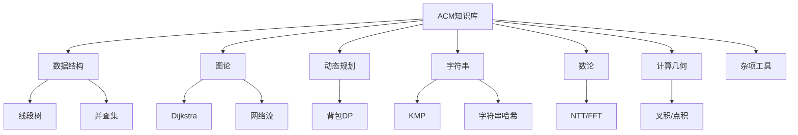

---
tags:
  - acm
  - wiki
  - moc
---

# ACM知识库总览

## 总知识目录

```text
ACM知识库
├── 数据结构
│   ├── [[并查集]]
│   ├── [[笛卡尔树]]
│   ├── [[可撤销并查集]]
│   ├── [[莫队]]
│   ├── [[权值线段树]]
│   ├── [[扫描线]]
│   ├── [[线段树]]
│   ├── [[线段树的其他用法]]
│   ├── [[线段树分治]]
│   ├── [[线段树合并与分裂]]
│   ├── [[线段树套线段树]]
│   ├── [[主席树]]
│   └── [[ST表]]
├── 图论
│   ├── [[边双连通分量]]
│   ├── [[差分约束]]
│   ├── [[点分治]]
│   ├── [[点双连通分量]]
│   ├── [[费用流]]
│   ├── [[欧拉路径与欧拉回路]]
│   ├── [[强连通分量]]
│   ├── [[树直径]]
│   ├── [[树重心]]
│   ├── [[虚树]]
│   ├── [[圆方树]]
│   ├── [[重链剖分]]
│   ├── [[最短路题目]]
│   ├── [[最小生成树]]
│   ├── [[Bellman–Ford 算法]]
│   ├── [[Dijkstra 算法]]
│   ├── [[Dinic]]
│   ├── [[DSU on Tree]]
│   ├── [[EK算法]]
│   ├── [[Floyd 算法]]
│   ├── [[Hall定理]]
│   ├── [[Johnson 算法]]
│   ├── [[Kruskal重构树]]
│   ├── [[LCA]]
│   └── [[SPFA算法]]
├── 动态规划
│   ├── [[01背包问题]]
│   ├── [[多重背包问题]]
│   ├── [[多重背包问题的二进制优化]]
│   ├── [[完全背包问题]]
│   └── [[SOS DP]]
├── 字符串
│   ├── [[后缀数组]]
│   ├── [[后缀自动机]]
│   ├── [[扩展kmp（Z函数）]]
│   ├── [[字符串哈希]]
│   ├── [[AC自动机]]
│   ├── [[KMP算法]]
│   ├── [[Manacher]]
│   └── [[Trie树]]
├── 数论
│   ├── [[狄利克雷卷积]]
│   ├── [[狄利克雷生成函数]]
│   ├── [[二项式反演]]
│   ├── [[矩阵快速幂]]
│   ├── [[快速傅里叶变换（FFT）]]
│   ├── [[快速数论变换（NTT）]]
│   ├── [[扩展欧几里得算法]]
│   ├── [[莫比乌斯反演]]
│   ├── [[普通生成函数]]
│   ├── [[数论分块]]
│   ├── [[线性基]]
│   ├── [[线性筛]]
│   ├── [[指数生成函数]]
│   ├── [[中国剩余定理]]
│   └── [[int128类定义]]
├── 计算几何
│   └── [[计算几何]]
├── 杂项工具
│   ├── [[随机]]
│   ├── [[异或哈希]]
│   ├── [[指数哈希]]
│   ├── [[ACM综合模板]]
│   ├── [[algorithm-note-template]]
│   ├── [[SKILL]]
│   ├── [[style-guide]]
│   ├── [[XCPC赛场Codebook]]
│   └── [[XCPC赛场Codebook更新指南]]
├── 题单与索引
│   └── [[题单]]
├── 知识库维护
│   └── [[算法笔记模板(算法)]]
```

## 分类入口

- [[数据结构]]
- [[图论]]
- [[动态规划]]
- [[字符串]]
- [[数论]]
- [[计算几何]]
- [[杂项工具]]
- [[题单与索引]]
- [[知识库维护]]

## 高频模板 TOP 15

1. [[线段树]]：区间查询/修改的核心模板；pushdown、区间边界和 Info 合并最容易在 10 分钟内写错。
2. [[并查集]]：连通性、最小生成树、离线合并的基础；注意路径压缩和可撤销版本不能混用。
3. [[Dijkstra 算法]]：非负权单源最短路首选；比赛里最容易漏 long long 和堆中过期状态判断。
4. [[LCA]]：树上距离、树上差分、虚树、路径查询的入口模板。
5. [[KMP算法]]：单模式串匹配和 border/周期问题基础；next 数组下标要统一。
6. [[字符串哈希]]：字符串判等、回文、LCP、去重常用；注意随机 base、双哈希和溢出策略。
7. [[Dinic]]：最大流标准版；分层图 BFS 与当前弧优化必须稳定。
8. [[费用流]]：最小费用最大流/费用最优匹配；势能优化和负边初始化要谨慎。
9. [[01背包问题]]：DP 入门高频；一维优化时容量必须倒序。
10. [[完全背包问题]]：无限件模型；一维优化时容量必须正序。
11. [[多重背包问题的二进制优化]]：多重背包常用优化；拆包后转 01 背包。
12. [[最小生成树]]：Kruskal/Prim 基础；与并查集、Kruskal 重构树联动。
13. [[AC自动机]]：多模式串匹配；fail 树贡献统计经常需要拓扑/DFS 汇总。
14. [[快速数论变换（NTT）]]：卷积整数模意义下的标准模板；原根、模数和 bit-reversal 易错。
15. [[计算几何]]：点线段圆基础；eps、叉积方向和边界判定决定成败。

## 易错知识 TOP 10

1. 线段树 pushdown 顺序错误：递归前忘记下放懒标记，或 tag 清零位置不对。
2. Dijkstra 用 int 存距离：边权和路径长度可能爆 int，优先使用 long long/INF=4e18。
3. SPFA 当作万能最短路：无负权图优先 Dijkstra；SPFA 最坏 O(nm)，还要负环计数。
4. 背包一维循环方向反了：01 背包倒序，完全背包正序，多重拆包后按 01 背包倒序。
5. 并查集可撤销版本路径压缩：回滚 DSU 不能路径压缩，只能启发式合并并记录栈。
6. 字符串哈希变量名/base 不一致：模板中 base/bs 容易写串，建议封装并双哈希校验。
7. Floyd 初始化不完整：d[i][i]=0，重边取 min，不可达判断用 INF/2。
8. KMP 下标体系混用：f[i+1] 与 next[i] 写法不同，匹配主串时要按同一套边界。
9. 网络流反向边编号错：addedge 必须成对建边，增广时用 i^1 找反向边。
10. 计算几何边界断言写反：相交/不相交返回值要先统一，eps 比较不能直接用 ==。

## 学习路径建议

### 初学顺序

1. [[并查集]]、[[线段树]]、[[01背包问题]]、[[完全背包问题]]
2. [[Dijkstra 算法]]、[[最小生成树]]、[[LCA]]
3. [[KMP算法]]、[[字符串哈希]]、[[Trie树]]
4. [[矩阵快速幂]]、[[线性基]]、[[快速傅里叶变换（FFT）]]

### 提升顺序

1. 数据结构进阶：[[主席树]]、[[权值线段树]]、[[线段树分治]]、[[莫队]]
2. 图论进阶：[[强连通分量]]、[[点双连通分量]]、[[Dinic]]、[[费用流]]
3. 字符串进阶：[[AC自动机]]、[[后缀自动机]]、[[Manacher]]
4. 数学进阶：[[快速数论变换（NTT）]]、[[普通生成函数]]、[[二项式反演]]

### 比赛前速刷顺序

1. 先看 [[ACM综合模板]]、[[线段树]]、[[并查集]]、[[Dijkstra 算法]]、[[LCA]]。
2. 再看 [[字符串哈希]]、[[KMP算法]]、[[Dinic]]、[[费用流]]、[[计算几何]]。
3. 最后扫一遍本页“易错知识 TOP 10”，把 long long、INF、数组范围、下标体系检查完。

## Obsidian 知识图谱


